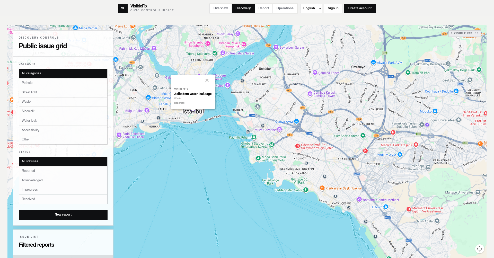

<div align="center">
  

  <h1 style="font-family: 'Inter', sans-serif; font-weight: 800; letter-spacing: -0.05em; margin-top: 0;">
    <span style="color: #000; background: #fff; padding: 0 10px; border: 4px solid #000;">VF</span> VisibleFix
  </h1>
  <p style="font-size: 1.2em; color: #555; font-style: italic;">Civic Transparency Through Public Visibility</p>

  <p>
    <a href="https://github.com/Krr0ptioN/visible-fix/actions"></a>
    
    
  </p>
</div>

---

## 🏛️ Project Purpose
VisibleFix is a community-powered observability platform for municipal infrastructure. It bridges the trust gap between citizens and local governments by transforming private complaints into **public, actionable data points**.

## 📜 The Manifesto
> **"An infrastructure problem is only a problem if people care about it."**

We believe that the infrastructure that matters is the infrastructure people actually report. Traditional systems are "black holes" where reports disappear. VisibleFix brings **transparency as accountability**:
- **Visibility:** Every report is public.
- **Validation:** Community upvotes signal collective priority.
- **Velocity:** Transparent status tracking (Reported → Fixed) creates social pressure for faster resolution.

## 💡 The Idea
VisibleFix treats municipal services like a production system. Just as engineers monitor servers to prevent outages, VisibleFix monitors the **human perception** of a city to detect issues before they become crises.

## 🚀 Getting Started
Ready to contribute or deploy? Follow our step-by-step guides:
- **[Local Development Setup](docs/SETUP.md#1-local-development-setup)**
- **[GCP Infrastructure Setup](docs/SETUP.md#2-gcp-infrastructure-setup-free-tier)**
- **[Production CI/CD Guide](docs/SETUP.md#3-production-deployment-cicd)**

## 🚀 Tech Stack
- **Monorepo:** [Nx](https://nx.dev)
- **Frontend:** Next.js (Tailwind CSS) - Deployed on **Vercel**
- **Backend:** NestJS (Node.js) - Deployed on **Google Cloud Run**
- **Database:** PostgreSQL (Drizzle ORM) - **Google Cloud SQL**
- **Mobile:** Expo / React Native
- **Infrastructure:** Terraform

## 🛠️ Development
```bash
# Install dependencies
pnpm install

# Run Web
pnpm nx serve web

# Run API
pnpm nx serve visiblefix-api

# Infrastructure
cd infra && terraform plan
```

## 📚 Documentation
- [Architecture (D2)](docs/architecture.md)
- [Development Guide](docs/dev-guide.md)

## 📈 Observability
Local metrics, logs, and traces stack lives in `infra/observability`:

```bash
docker compose -f infra/observability/docker-compose.yml up -d
```

Includes:
- Prometheus (metrics)
- Loki (logs)
- Tempo (traces)
- OpenTelemetry Collector
- Grafana (`http://localhost:3002`, `admin` / `admin`)

## 📊 Product Analytics & Error Monitoring
Web monitoring is integrated with:
- Google Analytics 4 (via `NEXT_PUBLIC_GA_MEASUREMENT_ID`)
- Sentry for Next.js (errors + traces + release source maps)

Required production environment variables:

```env
NEXT_PUBLIC_GA_MEASUREMENT_ID=G-XXXXXXXXXX
NEXT_PUBLIC_SENTRY_DSN=https://<key>@<org>.ingest.sentry.io/<project>
SENTRY_DSN=https://<key>@<org>.ingest.sentry.io/<project>
SENTRY_ORG=<sentry-org-slug>
SENTRY_PROJECT=<sentry-project-slug>
SENTRY_AUTH_TOKEN=<sentry-auth-token>
```

---

<div align="center">
  <p style="font-size: 0.9em; color: #888;">Aligned with UN SDG9: Industry, Innovation, and Infrastructure.</p>
</div>
