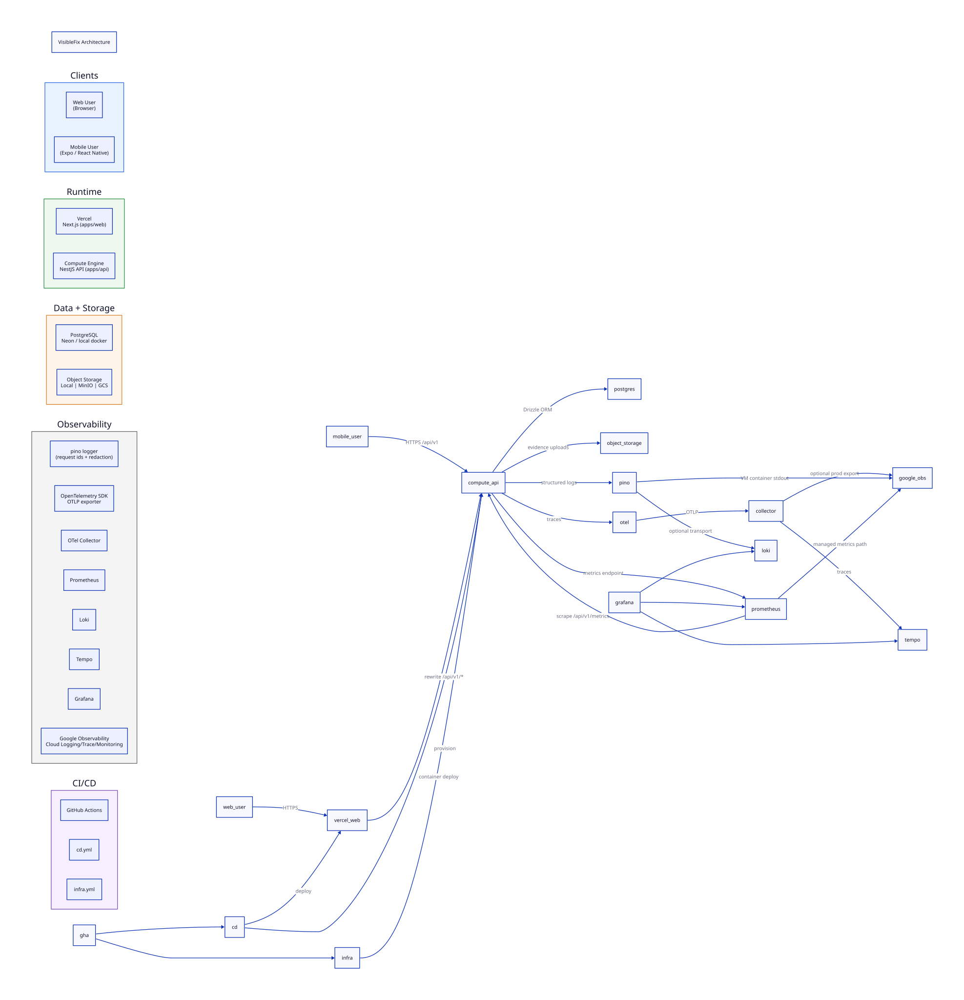

# VisibleFix Architecture



This document describes the current system architecture in this repository, including runtime, storage, and observability.

## 1. Core Runtime

- Web: Next.js app (`apps/web`), intended for Vercel deployment.
- API: NestJS app (`apps/api`), deployed to Google Compute Engine.
- Mobile: React Native / Expo (`apps/mobile`) using the same API contracts.
- Shared contracts/types: `libs/`.

## 2. Data and Storage

- Primary relational store:
  - Production: Neon PostgreSQL
  - Local: PostgreSQL via `infra/docker-compose.yml`
- Evidence photo object storage (adapter-based):
  - `ObjectStoragePort` abstraction
  - Adapters: local filesystem, MinIO (S3-compatible), Google Cloud Storage
  - Upload endpoint: `POST /api/v1/files/evidence`

## 3. API Design Notes

- Global prefix: `/api/v1`
- Evidence upload path: `/api/v1/files/evidence`
- Metrics endpoint: `/api/v1/metrics`
- Request logging:
  - `nestjs-pino` / `pino`
  - request-id propagation (`x-request-id`)
  - log redaction for sensitive fields

## 4. Observability Model

The backend emits all three telemetry signals:

- Logs: pino JSON logs, optional Loki shipping (`pino-loki`)
- Metrics: Prometheus format via `prom-client`
- Traces: OpenTelemetry (`@opentelemetry/sdk-node`) via OTLP exporter

Local observability stack (`infra/observability`):

- Prometheus (metrics)
- Loki (logs)
- Tempo (traces)
- OpenTelemetry Collector (ingest/forwarding)
- Grafana (unified query and correlation)

Google observability path:

- Cloud Logging for VM/container logs
- Cloud Trace for distributed traces
- Cloud Monitoring / Managed Service for Prometheus for metrics

## 5. Deployment Topology

- CD: `.github/workflows/cd.yml` (CI-gated API deploy followed by web deploy)
- Infra sync: `.github/workflows/infra.yml` (Terraform apply)
- Infra provisioning: Terraform in `infra/`

## 6. Diagram Source (D2)

- D2 source: `docs/architecture.d2`
- Rendered diagram: `docs/architecture.svg`

Regenerate:

```bash
rtk d2 docs/architecture.d2 docs/architecture.svg
```
